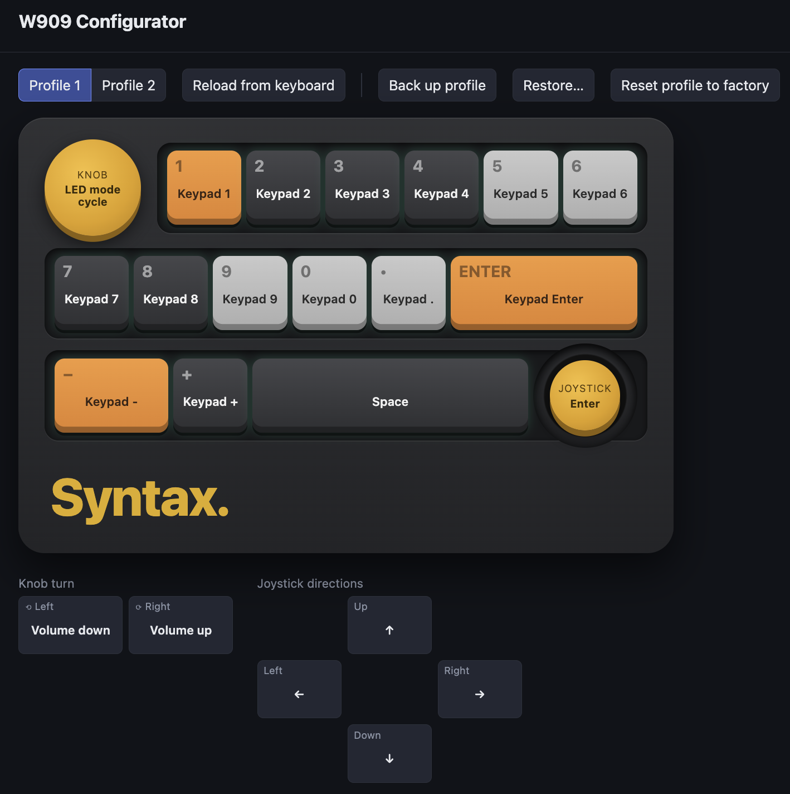

# W909 Configurator

A browser-based configurator for the **Syntax W909** macro pad (sold as the "W909 Pro" / "W909 Wireless macro"): 15 keys, a knob and a joystick.
Remap everything right from a web page, with no app to download.

**Try it without a keyboard:** open the page with `?demo` at the end of the address.



## Features

- **Remap any key, the knob press, the joystick press and its four directions,** and the knob's left/right turns.
- **Actions:**
  - normal keys
  - shortcuts like Ctrl+C (stored as macros)
  - typed text
  - media keys and app/browser launchers
  - mouse wheel
  - lighting controls
  - profile switching
  - Win/Mac mode and key locks
- **Two profiles,** each with its own keys, macros and lighting.
- **Lighting:** 8 effects plus off, with brightness, speed, direction and up to 7 colors.
- **Light shows:** animations played from the page (pulse, heartbeat, candle, police, strobe…) for 30 seconds,
  then your lighting comes back.
- **Press a key on the pad to select it** in the editor.
- **Power saving:** a sleep timer.
- **Backup, restore and factory reset** of a profile, using JSON files.
- Changes are written straight to the keyboard and survive unplugging.
- Shows the factory layout, greyed out, until a keyboard is connected. Shows setup tips automatically on Windows and Linux.

## Using it

1. Open the page in **Chrome, Edge, Brave or Opera** on a desktop computer. Safari, Firefox and phones don't support WebHID.
2. Plug the W909 in **with its USB cable**.
3. Click **Connect keyboard** and pick **"W909 Pro USB"**.

The page has to be served over **HTTPS** (or `localhost`), because browsers only allow USB access from secure pages.

### Wireless (2.4G receiver)
Over the receiver the keyboard reports its settings but ignores changes. The page detects this and switches to read-only.
Use the cable to make changes.

### Linux
Chrome needs permission to open the device. Run this once, then replug the keyboard:

```sh
sudo tee /etc/udev/rules.d/70-w909.rules <<'EOF'
SUBSYSTEM=="hidraw", ATTRS{idVendor}=="b6a4", ATTRS{idProduct}=="4100", MODE="0660", TAG+="uaccess"
SUBSYSTEM=="hidraw", ATTRS{idVendor}=="b6a4", ATTRS{idProduct}=="4101", MODE="0660", TAG+="uaccess"
EOF
sudo udevadm control --reload-rules && sudo udevadm trigger
```

Snap/Flatpak builds of Chromium may still be blocked by their sandbox; use a `.deb`/`.rpm` browser build.

### Windows
No driver is needed. If it won't connect, quit the vendor's SXS-W909 app (it can hold the device open) and plug the cable directly into the computer.

## Limitations

- The knob turns can't run macros (shortcuts or typed text).
- Macros play once or a set number of times. "Repeat while held" and "toggle" modes aren't supported.
- Typed text assumes a US keyboard layout.
- 16 macro slots per profile.
- Tested on firmware **2.3.0400**. The page shows a warning on other versions.

## How it works

The keyboard is configured through HID feature report 6 (40-byte command packets) on its vendor interface (USB `b6a4:4100`).
The protocol was worked out from the vendor's Windows app and verified against real hardware. It's documented in
[`device-info/PROTOCOL.md`](device-info/PROTOCOL.md), with sources and findings in [`device-info/README.md`](device-info/README.md).

```
web/                 the configurator (plain HTML/CSS/JS, no build step)
  index.html, style.css, app.js   UI
  w909-protocol.js                WebHID transport + commands
  w909-keys.js                    key/action tables, macro encoding, factory defaults
  w909-mock.js                    in-memory keyboard for ?demo
  w909-effects.js                 light show animations
device-info/         everything we learned: sources, findings, protocol reference, raw dumps
tools/               macOS command-line probe (Swift) and a protocol test harness
```

## Development

Serve the `web/` folder locally:

```sh
cd web && python3 -m http.server 8909
# open http://localhost:8909  (or http://localhost:8909/?demo)
```

To test the protocol code against a real keyboard (macOS):

```sh
swiftc -O tools/w909-bridge.swift -o tools/w909-bridge
node tools/test-protocol.mjs               # read-only checks
node tools/test-protocol.mjs --write-test  # also writes, then restores what it changed
```

## Deploying

`web/` is a static site with no build step. Serve that folder from any HTTPS static host.

## License

[MIT](LICENSE). The vendor's software isn't part of this repository.

## Disclaimer

This is an unofficial project, not affiliated with or endorsed by the keyboard's manufacturer. It writes settings
directly to your device. Use it at your own risk, and back up your profiles before experimenting.
